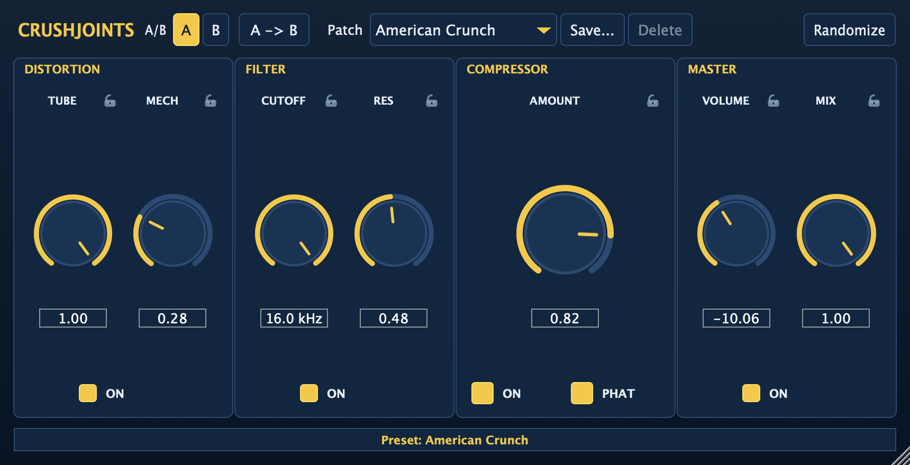

# CrushJoints

A JUCE-based distortion and compressor plugin, inspired by the classic CamelCrusher by Camel Audio. As I struggled
to get the original to work on my new system, I had to compromise and tinker alot with other options when opening 
older projects. Even then, sometimes the results still left something to be desired, so as an avid enjoyer of the
original, this project was incepted. It has to be stated, that this is no attempt of a complete one-to-one clone
of the plugin, but rather an attempt to approximate the original's sounds as close as possible. This allows to 
add some extra features, while still offering the same sound.  
This project is heavily influenced/inspired by other peoples projects, specifically:
 - **[reverse-camel](https://github.com/soerenbnoergaard/reverse-camel)**: for the black box analysis of the tube and mech distortion modules
 - **[CrushClone](https://github.com/doxiedevops/CrushClone)**: for the general idea of building this (also I snatched their presets)

## Overview



The fundamental aim of CrushJoints is to be a faithful recreation of the CamelCrusher effect chain. 
In this regard it is featuring:
- Tube and Mech distortion dials
- 12 dB/octave low-pass filter with resonance (Q 1–7)
- One-knob compressor with Phat mode
- A "Randomize" button
- Master volume and mix controls
- The 20 presets of the original

Beyond that, CrushJoints also has:
- A/B parameter comparison with copy-between-slots
- A resizable interface
- Per-parameter randomize locks
- 11 additional CrushClone presets
- Native mono/stereo bus support for mono tracks

## Install

> **important note:** The functionality of the plugin was, to this point, only tested on MacOS on Reaper 7.
> Although GitHub compiles versions for both Windows and Linux. I don't have the means to test them. If you are
> running the plugin on either of these systems and it does (not) work for you, let me know!

1. Go to the release page and download the appropriate file for your system
2. There is no installer, just the plain VST3/AU plugin files, so you have to copy them 
 wherever these usually live on your system. That means in generally:
   - **for macOS**: `CrushJoints.vst3` → `~/Library/Audio/Plug-Ins/VST3/` and
     `CrushJoints.component` → `~/Library/Audio/Plug-Ins/Components/`
     (use `/Library/Audio/Plug-Ins/...` to install for all users)
   - **for Windows**: the `CrushJoints.vst3` folder → `C:\Program Files\Common Files\VST3\`
   - **for Linux**: the `CrushJoints.vst3` folder → `~/.vst3/`
     (or `/usr/lib/vst3/` for a system-wide install)
3. Start your DAW. If this is not done automatically, let it rescan for new plugins.


## Building (MacOS)

### Prerequisites
- Xcode Command Line Tools
- CMake 3.22 or newer
- A JUCE 8/9 source checkout (tested with JUCE 9.0.4)

### Build Steps
1. Clone the repo
2. Point CMake at your JUCE checkout:
   ```sh
   cmake -B build -DCMAKE_BUILD_TYPE=Release -DJUCE_ROOT=/path/to/JUCE
   ```
3. Build:
   ```sh
   cmake --build build --config Release -j8
   ```

The built artefacts are in `build/CrushJoints_artefacts/Release/`.
Copy the VST3/AU bundles to `~/Library/Audio/Plug-Ins/VST3/` and
`~/Library/Audio/Plug-Ins/Components/` respectively.

Run the offline tests with:

```sh
./build/CrushJointsTests_artefacts/Release/CrushJointsTests
./build/CrushJointsProcessorTests_artefacts/Release/CrushJointsProcessorTests
```

User presets are saved to
`~/Library/Application Support/CrushJoints/Presets.xml` on macOS.

## Development

Project documentation lives in [docs/](docs/):

- [Background](docs/RESEARCH.md) — CamelCrusher history, manual, original UI and sources
- [Measurements](docs/MEASUREMENTS.md) — measured behaviour of the original (ground truth)
- [Architecture](docs/ARCHITECTURE.md) — build, signal chain, parameters, presets, state and editor
- [Status](docs/STATUS.md) — tests, validation results, known gaps and deviations
- [Roadmap](docs/ROADMAP.md) — version scope, milestones and idea backlog

This project follows a phased development approach described in the roadmap.

## License

This project is licensed under the GPLv3 license - see the LICENSE file for details.
